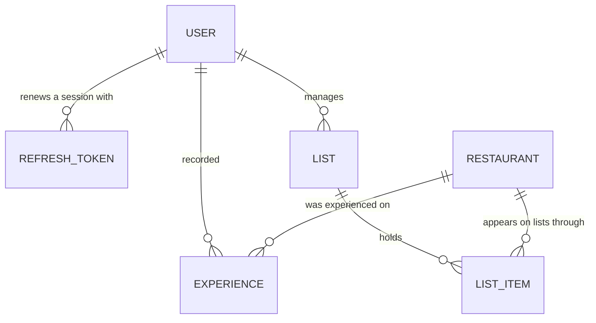

# Shortlist Data Model

## Entities

- **Experience** — one occasion of eating at a Restaurant, and what the owner thought of it.
- **List** - one group of restaurants, managed by the list owner
- **List item** — one Restaurant's place on one List, and when the owner put it there. The thing a User adds and removes; the Restaurant itself is shared and outlives it.
- **Refresh token** — one device's standing permission to keep renewing a **Session** without signing in again. Not the token the API authenticates requests with — see **Session** in the glossary.
- **Restaurant** — one wrapper for a Google Place, shared by every List that holds it. Nobody owns one.
- **User** — one list owner: who they are, how they sign in, and the hashed credential they sign in with. The whole of identity in Shortlist; there is no second record behind it.

## Attributes

### User

| Attribute       | Semantic type                  | Optional | Meaning                                                                      |
| --------------- | ------------------------------ | -------- | ---------------------------------------------------------------------------- |
| id              | identifier (bigint, generated) | no       | Shortlist's own key for this User.                                           |
| email           | email address                  | no       | The address the owner signs in with. Unique, stored lowercased and trimmed.  |
| password digest | bcrypt digest                  | no       | The hash of the password. Never the password, and never leaves the database. |
| name            | short text                     | no       | One value, not split into first and last.                                    |
| created at      | UTC timestamp                  | no       |                                                                              |
| updated at      | UTC timestamp                  | no       |                                                                              |

### Refresh token

| Attribute  | Semantic type                       | Optional | Meaning                                                                     |
| ---------- | ----------------------------------- | -------- | --------------------------------------------------------------------------- |
| id         | identifier (bigint, generated)      | no       |                                                                             |
| user       | reference (User)                    | no       | Whose session this is.                                                      |
| token      | opaque secret (random, unguessable) | no       | What a device presents to be issued a fresh pair. Unique.                   |
| issued at  | UTC timestamp                       | no       | When this token was minted — at sign-in, or at the renewal that rotated it. |
| expires at | UTC timestamp                       | no       | Thirty days after it was issued.                                            |

A row is created at sign-in and replaced at every renewal: the presented row is destroyed and a new one issued in its place, so a refresh token is good for exactly one use. Signing out destroys every row the User has.

### Restaurant

| Attribute       | Semantic type              | Optional | Meaning                     | Source                              |
| --------------- | -------------------------- | -------- | --------------------------- | ----------------------------------- |
| google_place_id | identifier                 | no       |                             | User lookup                         |
| name            | short text, 1–255, trimmed | no       |                             | Cached value from Google Place data |
| address line 1  | short text                 | yes      |                             | Cached value from Google Place data |
| address line 2  | short text                 | yes      |                             | Cached value from Google Place data |
| city            | short text                 | yes      |                             | Cached value from Google Place data |
| state           | short text                 | yes      |                             | Cached value from Google Place data |
| postal code     | short text                 | yes      |                             | Cached value from Google Place data |
| country         | short text                 | yes      |                             | Cached value from Google Place data |
| cuisine         | short text                 | yes      | What kind of food it serves | Cached value from Google Place data |
| created at      | UTC timestamp              | no       | Rails default               |                                     |
| updated at      | UTC timestamp              | no       | Rails default               |                                     |

A Restaurant represents one Google Place, and there is one row per Place for the whole system. Users do not own or manage Restaurants directly; they add and remove **List items**, which they do own. Two owners who both have "Tacos El Bronco" have two List items pointing at one Restaurant.

### List

| Attribute | Semantic type              | Optional | Meaning            | Defaut    |
| --------- | -------------------------- | -------- | ------------------ | --------- |
| id        | identifier                 | no       |                    |           |
| name      | short text, 1–255, trimmed | no       |                    | "My List" |
| user      | reference (User)           | no       | Whose List this is |           |

### List item

| Attribute  | Semantic type                  | Optional | Meaning                                              |
| ---------- | ------------------------------ | -------- | ---------------------------------------------------- |
| id         | identifier (bigint, generated) | no       |                                                      |
| list       | reference (List)               | no       | Which List holds it.                                 |
| restaurant | reference (Restaurant)         | no       | Which Restaurant it puts on that List.               |
| added at   | UTC timestamp                  | no       | When the owner put this Restaurant on the List.      |
| updated at | UTC timestamp                  | no       |                                                      |

### Experience

| Attribute   | Semantic type                                          | Optional | Meaning                                                                  |
| ----------- | ------------------------------------------------------ | -------- | ------------------------------------------------------------------------ |
| id          | identifier (bigint, generated)                         | no       |                                                                          |
| restaurant  | reference (Restaurant)                                 | no       | Which Restaurant this Experience happened at.                            |
| user        | reference (User)                                       | no       | Whose Experience this is.                                                |
| rating      | decimal, one of the nine values under **Enumerations** | yes      | Stars (and half-stars) for this one experience.                          |
| notes       | long text                                              | yes      | Whatever the user wants to remember                                      |
| occurred on | date                                                   | yes      | The day it happened                                                      |
| recorded at | UTC timestamp                                          | no       | When the owner wrote it down, which is not necessarily when it happened. |
| updated at  | UTC timestamp                                          | no       |                                                                          |

## Identity

- **User** — its email, case- and whitespace-insensitive
- **List** - its name, scoped per user
- **Refresh token** — its `token` value, which is globally unique because it is random and long enough not to collide
- **Restaurant** — its google place id
- **List item** — its List and its Restaurant together. One List never holds the same Restaurant twice.

## Relationships

| From       | To            | Cardinality | Optionality                                                                    |
| ---------- | ------------- | ----------- | ------------------------------------------------------------------------------ |
| User       | Refresh token | one to many | A User with none is signed out everywhere                                      |
| User       | List          | one to many |                                                                                |
| List       | List item     | one to many | A List with none is empty. A List item is on exactly one List.                 |
| Restaurant | List item     | one to many | A Restaurant on nobody's List has no List items, and is kept anyway.           |
| Restaurant | Experience    | one to many | An Experience happened at exactly one Restaurant.                              |
| User       | Experience    | one to many | An Experience has exactly one owner.                                           |

## Invariants

- The default list is called "My List" and is created when the user is created
- An Experience carries at least one of `rating`, `notes`, or `occurred_on`. All three absent is not an Experience.
- An Experience's `occurred_on` is never later than the day it is recorded. A future date is a typo rather than a booking.
- An Experience's `occurred_on` may be earlier than the `added_at` of the owner's List item for that Restaurant. Recording an Experience that happened long before the Restaurant went on the List is normal.
- A List holds a given Restaurant at most once. A second add is the rejection in `managing-my-list.scenarios.md`, not a second List item.
- An Experience does not require a List item. Removing a Restaurant from a List leaves that owner's Experiences standing, out of reach until it goes back on.
- A User's `email` is unique across all Users, compared lowercased and trimmed
- A User always has a `password_digest`
- A Refresh token's `expires_at` is later than its `issued_at`

## Enumerations

**Experience rating** — exactly one of `1`, `1.5`, `2`, `2.5`, `3`, `3.5`, `4`, `4.5`, `5`. Nine values, no zero, and can be empty.

Intentionally held as a decimal rather than an enumerated type, because half-stars are a number and arithmetic over them stays obvious.

## Derived

Not stored.

- **experience count** — how many Experiences *one User* has at a Restaurant. **Visited** is this being greater than zero. Both are per owner: a Restaurant is never visited in its own right, only visited by somebody, so another owner's Experiences never show on my List item.
- **last experienced on** — the latest `occurred_on` across that same User's Experiences at the Restaurant; absent when they have none, or when none of them carry a date.
- **expired** — a Refresh token whose `expires_at` has passed. Not a column: the comparison is made when the token is presented, so nothing has to sweep the table for correctness.

## Ownership

- Nothing erases restaurants. A Restaurant outlives every List item that points at it.
- A user can manage their lists
- A user can add and remove list items, which is how a restaurant goes on and comes off their list.
- Removing a list item destroys that row and nothing else. The Restaurant stands, and so do the owner's Experiences at it.
- A user can manage their own experiences.
- A user owns their refresh tokens.
- Deleting a User deletes their lists, list items, experiences, and refresh tokens.
- Nothing in the application deletes a User. Removing somebody means an administrator doing it by hand.

## History and retention

No entity keeps a history of its own changes; an edit overwrites.

Refresh tokens are the exception in the other direction: they are destroyed rather than retained, on renewal and on sign-out, so the table holds only what is currently live. Nothing keeps a record of past sessions.

<!-- alloy: data-model -->
