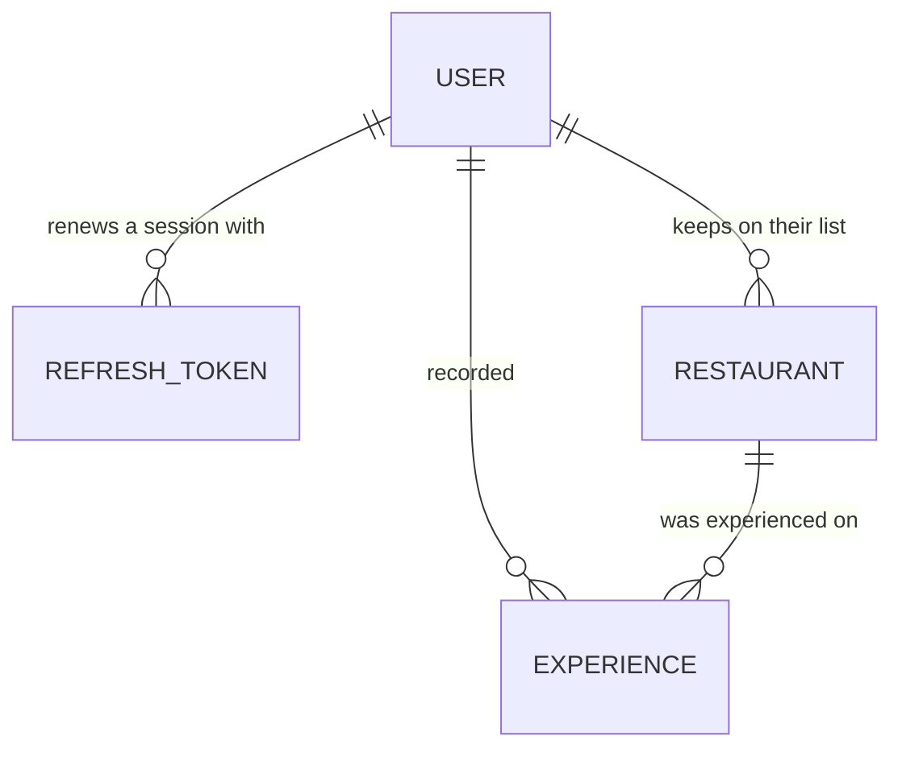

# Shortlist Data Model

## Entities

- **User** — one list owner: who they are, how they sign in, and the hashed credential they sign in with. The whole of identity in Shortlist; there is no second record behind it.
- **Refresh token** — one device's standing permission to keep renewing a **Session** without signing in again. Not the token the API authenticates requests with — see **Session** in the glossary.
- **Restaurant** — one owner's private record of a place to eat, whether or not they have been there.
- **Experience** — one occasion of eating at a Restaurant, and what the list owner thought of it.

## Attributes

### User

| Attribute       | Semantic type                  | Optional | Meaning                                                                      |
| --------------- | ------------------------------ | -------- | ---------------------------------------------------------------------------- |
| id              | identifier (bigint, generated) | no       | Shortlist's own key for this User.                                           |
| email           | email address                  | no       | The address the owner signs in with. Unique, stored lowercased and trimmed.  |
| password digest | bcrypt digest                  | no       | The hash of the password. Never the password, and never leaves the database. |
| name            | short text                     | no       | One value, not split into first and last.                                    |
| created at      | UTC timestamp                  | no       |                                                                              |
| updated at      | UTC timestamp                  | no       |                                                                              |

A User is created by an administrator, by hand, with a name, an email and a password they then hand to the owner. Nothing in Shortlist drives that — there is no sign-up, no invitation record, and no email, so there is nothing to expire and nothing to use twice. `signing-in.scenarios.md` carries what the owner is told the first time they sign in as an open question.

An account created without a name is an administrator error rather than a case to tolerate. That is what keeps `name` required: there is no moment at which a User exists without one, so nothing downstream has to render a nameless owner.

The password the owner is handed is at least 8 characters, which is the only rule Shortlist states about one. Nothing checks it against a breach list, requires a mix of character classes, expires it, or remembers previous ones.

### Refresh token

| Attribute  | Semantic type                      | Optional | Meaning                                                                      |
| ---------- | ---------------------------------- | -------- | ---------------------------------------------------------------------------- |
| id         | identifier (bigint, generated)     | no       |                                                                              |
| user       | reference (User)                   | no       | Whose session this is.                                                       |
| token      | opaque secret (random, unguessable) | no      | What a device presents to be issued a fresh pair. Unique.                    |
| issued at  | UTC timestamp                      | no       | When this token was minted — at sign-in, or at the renewal that rotated it.  |
| expires at | UTC timestamp                      | no       | Thirty days after it was issued.                                             |

A row is created at sign-in and replaced at every renewal: the presented row is destroyed and a new one issued in its place, so a refresh token is good for exactly one use. Signing out destroys every row the User has. Nothing reads these rows back for display — they are not a "devices" list — and nothing yet prunes expired ones.

### Restaurant

| Attribute       | Semantic type                      | Optional | Meaning                                                                                                                    |
| --------------- | ---------------------------------- | -------- | -------------------------------------------------------------------------------------------------------------------------- |
| id              | identifier (bigint, generated)     | no       |                                                                                                                            |
| user            | reference (User)                   | no       | The owner whose list this Restaurant is on.                                                                                |
| name            | short text, 1–255, trimmed         | no       | The only thing a Restaurant cannot be created without.                                                                     |
| url             | URL, `http`/`https` only, max 2048 | yes      | The restaurant's own site.                                                                                                 |
| google maps url | URL, `http`/`https` only, max 2048 | yes      | Its Google Maps entry.                                                                                                     |
| yelp url        | URL, `http`/`https` only, max 2048 | yes      | Its Yelp entry.                                                                                                            |
| address line 1  | short text                         | yes      |                                                                                                                            |
| address line 2  | short text                         | yes      |                                                                                                                            |
| city            | short text                         | yes      |                                                                                                                            |
| state           | short text                         | yes      |                                                                                                                            |
| postal code     | short text                         | yes      |                                                                                                                            |
| country         | short text                         | yes      |                                                                                                                            |
| cuisine         | short text                         | yes      | What kind of food it serves. The one address-adjacent field the list filters on.                                           |
| specialty       | short text                         | yes      | The dish it is known for.                                                                                                  |
| notes           | long text                          | yes      | Standing facts and reasons to go — see **Notes** in the glossary.                                                          |
| added at        | UTC timestamp                      | no       | When it went on the list.                                                                                                  |
| updated at      | UTC timestamp                      | no       |                                                                                                                            |
| removed at      | UTC timestamp                      | yes      | Set when the owner takes it off the list; its presence is what **Removed** means. Never leaves the system in any response. |

### Experience

| Attribute   | Semantic type                                          | Optional | Meaning                                                                                    |
| ----------- | ------------------------------------------------------ | -------- | ------------------------------------------------------------------------------------------ |
| id          | identifier (bigint, generated)                         | no       |                                                                                            |
| restaurant  | reference (Restaurant)                                 | no       | Which Restaurant this Experience happened at.                                              |
| user        | reference (User)                                       | no       | Whose Experience this is. Policed by the invariant that it matches the Restaurant's owner. |
| rating      | decimal, one of the nine values under **Enumerations** | yes      | Stars (and half-stars) for this one experience.                                            |
| notes       | long text                                              | yes      | Whatever the user wants to remember                                                        |
| occurred on | date                                                   | yes      | The day it happened                                                                        |
| recorded at | UTC timestamp                                          | no       | When the owner wrote it down, which is not necessarily when it happened.                   |
| updated at  | UTC timestamp                                          | no       |                                                                                            |

## Identity

- **User** — its email, case- and whitespace-insensitive. There is one account per address, which is what makes an address a thing an administrator can look somebody up by.
- **Refresh token** — its `token` value, which is globally unique because it is random and long enough not to collide.
- **Restaurant** — its name, case- and whitespace-insensitive, within one owner's non-removed Restaurants. A name is reusable once the Restaurant carrying it is Removed, because a Removed Restaurant is invisible. Names are not unique across owners.

## Relationships

| From | To            | Cardinality | Optionality                                                              |
| ---- | ------------- | ----------- | ------------------------------------------------------------------------ |
| User | Refresh token | one to many | A User with none is signed out everywhere; that is the normal resting state. |
| User | Restaurant    | one to many |                                                                          |
| Restaurant | Experience | one to many | An Experience happened at exactly one Restaurant.                        |
| User | Experience    | one to many | An Experience has exactly one owner.                                     |

## Invariants

- An Experience carries at least one of `rating`, `notes`, or `occurred_on`. All three absent is not an Experience.
- An Experience's owner is the same User as its Restaurant's owner.
- Among one owner's non-removed Restaurants, `name` is unique.
- A Restaurant's `name`, once trimmed, is at least one character. Whitespace alone is not a name.
- An Experience's `occurred_on` is never later than the day it is recorded. A future date is a typo rather than a booking.
- An Experience's `occurred_on` may be earlier than its Restaurant's `added_at`. Recording an Experience that happened long before the Restaurant was added is normal.
- A User's `email` is unique across all Users, compared lowercased and trimmed.
- A User always has a `password_digest`. There is no credential-less account, because there is no sign-up flow that could create one half-finished.
- A Refresh token's `expires_at` is later than its `issued_at`. A token that is expired the moment it is minted is a bug, not a revocation.

## Enumerations

**Experience rating** — exactly one of `1`, `1.5`, `2`, `2.5`, `3`, `3.5`, `4`, `4.5`, `5`. Nine values, no zero, and can be empty.

Intentionally held as a decimal rather than an enumerated type, because half-stars are a number and arithmetic over them stays obvious.

## Derived

Not stored.

- **experience count** — how many Experiences a Restaurant has. **Visited** is this being greater than zero.
- **last experienced on** — the latest `occurred_on` across a Restaurant's Experiences; absent when it has none, or when none of them carry a date.
- **expired** — a Refresh token whose `expires_at` has passed. Not a column: the comparison is made when the token is presented, so nothing has to sweep the table for correctness.

## Ownership

- A Restaurant owns its Experiences: were a Restaurant ever erased for real, its Experiences would go with it. Nothing erases Restaurants, which is the point of **Removed** — a hard delete would destroy the experience history as a side effect of tidying the list.
- A User owns their Restaurants, their Experiences and their Refresh tokens. Deleting a User cascades to all three, destroying every restaurant and every note they ever recorded.
- Nothing in the application deletes a User. Removing somebody means an administrator doing it by hand, and there is no undo — which is the same act that used to be a deletion in a vendor's dashboard, now on this side of the boundary.

## History and retention

No entity keeps a history of its own changes; an edit overwrites. **Removed** buys retention, not recovery: the row survives, but nothing reads it back.

Refresh tokens are the exception in the other direction: they are destroyed rather than retained, on renewal and on sign-out, so the table holds only what is currently live. Nothing keeps a record of past sessions, which means nothing can answer "where was I signed in last week."

<!-- alloy: data-model -->
