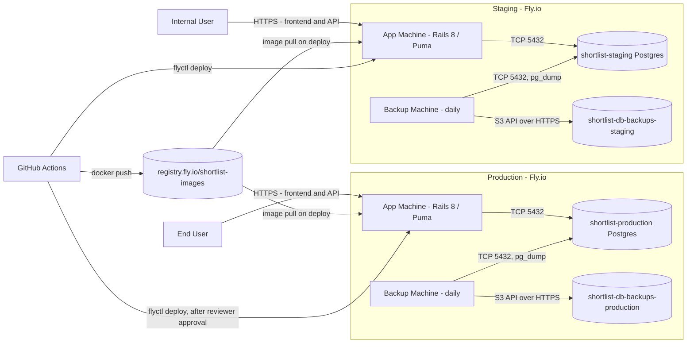

# Shortlist Deployment View

## Environments

Production: User-facing, always available
Staging: For testing things before full deployment

Test: Local test environment, covered in development view
Local: Local dev environment, covered in development view

## Nodes

Everything runs on Fly.io.

Each environment is one Fly organization app plus a scheduled machine:

| Node             | Host   | Runtime                                     | Notes                                                                 |
| ---------------- | ------ | ------------------------------------------- | --------------------------------------------------------------------- |
| App machine      | Fly.io | Ruby 3.4 / Rails 8 / Puma                   | Serves the JSON API and the built frontend assets from the same image |
| Postgres machine | Fly.io | PostgreSQL 18, self-managed in a container  | Attached volume                                                       |
| Backup machine   | Fly.io | Same image as the app machine, `bin/backup` | Scheduled daily, boots and exits; does not serve traffic              |

Per environment:

| Environment | App                    | VM size                | `primary_region` | Auto-stop                                 | Volume size |
| ----------- | ---------------------- | ---------------------- | ---------------- | ----------------------------------------- | ----------- |
| Production  | `shortlist-production` | shared-cpu-1x / 512 MB | TBD              | No — always-on, for first-request latency | TBD         |
| Staging     | `shortlist-staging`    | shared-cpu-1x / 512 MB | TBD              | Yes — app and Postgres stop when idle     | TBD         |

## Stateful resources

Per environment, each in its own Fly app so nothing is shared:

| Environment | Database                                        | Backup bucket                              |
| ----------- | ----------------------------------------------- | ------------------------------------------ |
| Production  | PostgreSQL 18, Fly machine with attached volume | `shortlist-db-backups-production` (Tigris) |
| Staging     | PostgreSQL 18, Fly machine with attached volume | `shortlist-db-backups-staging` (Tigris)    |

Buckets are Tigris, Fly's S3-compatible object storage. The S3 API and tooling apply but the bucket is not in AWS.

The only thing shared by both environments:

| Resource                           | What it holds                                                       |
| ---------------------------------- | ------------------------------------------------------------------- |
| `registry.fly.io/shortlist-images` | Container images tagged by git SHA. The artifact that gets promoted |

`shortlist-images` is a Fly app that exists only as a registry namespace and runs nothing. Both environment apps pull from it, so we can promote a specific image from staging to production.

The frontend has no stateful resource of its own: assets are baked into the container image and served by the app machine.

### Backups

Nightly `pg_dump` from the backup machine to that environment's Tigris bucket. Retention is a bucket lifecycle rule, not a step in the script.

Fly also takes daily volume snapshots of the Postgres volume automatically. Those are a bonus, not the backup: they only restore into Fly, and they live in the same account as the thing they protect.

Restore procedure: TBD. The dumps have never been restored, so the backup is unverified.

## Connections

Both the frontend and the API are the same origin, because the app machine serves both. There is no CORS boundary and no second host.

## Forbidden connections

No Production node ever reaches a Staging resource, and no Staging node ever reaches a Production resource — in particular, the Staging app never connects to the Production database or its backup bucket, and vice versa. A connection between them risks corrupting production data or user experience.

The container registry is the one resource both environments touch: it is how the promoted artifact reaches Production. It holds images only. No environment ever reads another environment's data through it.

Local and Test never reach any hosted environment. They are covered in the development view.

## Configuration

What differs per environment is a checked-in `fly.<env>.toml` — `fly.production.toml` and `fly.staging.toml` — holding the app name, `primary_region`, VM size, HTTP service and ports, health checks, auto-stop, non-secret env vars, and `release_command`.

`flyctl deploy --config fly.<env>.toml` reconciles the running app to that file, so configuration changes are reviewed in a pull request rather than applied by hand.

One-time provisioning is not in `fly.toml`: creating the apps, volumes, Postgres, Tigris buckets and certificates is a Make target of idempotent `flyctl` commands.

## Secrets

Two sources, for two different consumers.

**Runtime**, read by the app and backup machines: set with `flyctl secrets set` per app, never in `fly.toml`. Names are in `.env.example`; values live only in Fly. Tigris credentials are injected by Fly when the bucket is provisioned rather than set by hand.

**Deploy-time**, read by GitHub Actions: a single `FLY_API_TOKEN`, scoped per app, held as an environment secret on the matching GitHub Environment. That is the only credential CI holds.

The repo is public, so the test jobs must never be able to read it. Workflows triggered by a pull request from a fork get no secrets by default, and the deploy jobs are bound to environments that only `main` can reach — both halves of that are load-bearing, not incidental.

Who can read them: anyone with access to the Fly organization, anyone with write access to the repository, and any required reviewer on the `production` environment. Narrowing that is TBD.

## Promotion Path

CI/CD is GitHub Actions. Every commit landing on the `main` branch starts the pipeline. Pull requests run the two test jobs only.

| Stage               | What it does                                                                                                                                                                                   | Gate                                        |
| ------------------- | ---------------------------------------------------------------------------------------------------------------------------------------------------------------------------------------------- | ------------------------------------------- |
| `test-backend`      | RSpec against a Postgres service container, plus RuboCop                                                                                                                                       | —                                           |
| `test-frontend`     | vitest and oxlint                                                                                                                                                                              | —                                           |
| `build`             | Builds the image — frontend assets compiled in an earlier stage and copied into `public/` — tags it with the git SHA, pushes to `registry.fly.io/shortlist-images`. Layer cache via `type=gha` | Both test jobs pass                         |
| `deploy-staging`    | `flyctl deploy --config fly.staging.toml --image …:$SHA`, bound to the `staging` GitHub Environment                                                                                            | `build` passes; `main` only                 |
| `deploy-production` | `flyctl deploy --config fly.production.toml --image …:$SHA`, bound to the `production` GitHub Environment                                                                                      | A required reviewer approves the deployment |

Both deploy jobs install flyctl with `superfly/flyctl-actions/setup-flyctl` and read `FLY_API_TOKEN` from their environment, so neither job can reach the other's credential.

There is no separate approval job. `production` is a protected environment with a required reviewer, so the run pauses before `deploy-production` starts and resumes when it is approved — the gate is a property of the environment rather than a step in the workflow. GitHub records each run in the repository's Deployments view, which is where to look for what SHA is live in each environment.

Nothing is rebuilt to promote. Both deploy jobs reference the same image tag, so what gets approved is the artifact the tests passed against, and there is no separate promote pipeline and no SHA to re-verify.

The pending approval belongs to the workflow that built the image, so promotion targets the commit that just landed. Promoting an arbitrary older SHA is not supported; it would need a second `workflow_dispatch` workflow taking the tag as an input.

Migrations run via `release_command = "bin/rails db:migrate"` in each `fly.toml`. Fly runs it before new machines take traffic and fails the release if it exits non-zero, so a failed migration is a failed deploy. Because the previous machines serve throughout, every migration must be safe against the currently-running code.

<!-- alloy: deployment -->
